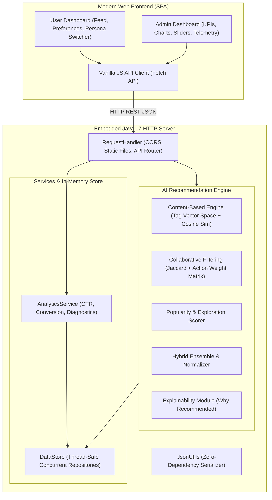

<div align="center">

# 🔮 AI-Based Recommendation System
### Intelligent Multi-Strategy Product & Content Recommender with Real-Time Feedback & Analytics

[](https://adoptium.net/)
[](LICENSE)
[]()
[]()
[]()

<p align="center">
  <b>A production-grade, zero-external-dependency Java web application combining Content-Based Filtering, Collaborative User-User Filtering, Explainable AI (XAI), and Real-Time Admin Telemetry.</b>
</p>

[Key Features](#-key-features) •
[Architecture](#-system-architecture) •
[Recommendation Algorithms](#-recommendation-engine-math--algorithms) •
[Quick Start](#-quick-start-guide) •
[API Documentation](#-rest-api-reference) •
[Docker Deployment](#-docker-deployment) •
[Contributing](#-contributing)

---

</div>

## 📌 Overview

The **AI-Based Recommendation System** is designed to tackle the fundamental challenges of modern personalized recommendation engines:
1. **Dynamic Preference Adaptation**: Continuously adjusts user affinity weights in real-time as users interact (clicks, ratings, likes, purchases).
2. **Cold-Start Resilience**: Leverages exploration bonuses and content similarity to handle new users and zero-history items.
3. **Explainable AI (XAI)**: Generates transparent, human-readable explanations (*"Why recommended"*) for every item in the catalog.
4. **Admin Telemetry & Performance Monitoring**: Provides business stakeholders with real-time analytics including Click-Through Rate (CTR), Purchase Conversion Rate, Catalog Coverage, and automated diagnostic insights.

---

## ✨ Key Features

### 🛍️ User Experience & Preference Dashboard
- **Personalized Recommendations Feed**: Instant ranking based on hybrid affinity matching with percentage compatibility scores (e.g., *96% AI Match*).
- **Preference Management Center**: Modal controls to configure interested categories and budget bounds ($Min - $Max) with instant feed recalculation.
- **Interactive Multi-Action Signals**:
  - 👁️ **View Details**: Logs implicit browsing interest.
  - ❤️ **Like**: High affinity positive feedback.
  - 🔖 **Bookmark**: High-intent save for later.
  - ⭐ **5-Star Rating**: Explicit numerical feedback (1-5 stars) dynamically shifting preference weights.
  - 🛒 **Purchase**: Maximum interaction weight driving strong collaborative similarity.
- **Persona Switcher**: Seamlessly switch between demo users (*Alex Carter [Tech/Gaming]*, *Sarah Connor [Fitness/Books]*, *David Kim [Home/Tech]*, *Emma Watson [Fashion/Eco]*) or register new profiles on the fly.

### ⚙️ Admin Monitoring & Algorithmic Controls
- **Live Effectiveness Dashboard**: Real-time KPI cards for **CTR (%)**, **Conversion Rate (%)**, **Catalog Coverage (%)**, and **Average User Satisfaction**.
- **Actionable AI Diagnostics**: Automated advisory warnings that inspect real-time metrics and propose specific algorithmic tuning parameters.
- **Dynamic Hyperparameter Tuning**: Live sliders for $w_{\text{content}}$, $w_{\text{collab}}$, $w_{\text{pop}}$, $w_{\text{div}}$, and similarity cutoffs without restarting the server.
- **Interactive Analytics Visualizations**: Category interaction bar graphs, event distribution breakdowns, and live user profile registers.

---

## 🏗️ System Architecture



---

## 📐 Recommendation Engine Math & Algorithms

### 1. Hybrid Ensemble Formula
Every product $p$ is scored for a target user $u$ using a configurable linear ensemble:

$$\text{Score}(u, p) = w_{\text{content}} \cdot S_{\text{content}}(u, p) + w_{\text{collab}} \cdot S_{\text{collab}}(u, p) + w_{\text{pop}} \cdot S_{\text{pop}}(p) + w_{\text{div}} \cdot S_{\text{div}}(u, p)$$

Subject to:
$$w_{\text{content}} + w_{\text{collab}} + w_{\text{pop}} + w_{\text{div}} = 1.0$$

### 2. Content-Based Filtering ($S_{\text{content}}$)
Measures the alignment between user preference vectors and product metadata:
- **Category Match ($0.35$)**: Binary match if $p.\text{category} \in u.\text{preferredCategories}$.
- **Tag Affinity ($0.50$)**: Normalized sum of user tag weights for matching item tags:
  $$S_{\text{tags}} = \frac{1}{|p.\text{tags}|} \sum_{t \in p.\text{tags}} \min(\text{Affinity}(u, t), 6.0)$$
- **Price Budget Compatibility ($0.15$)**: Scaled Gaussian/linear penalty if item price deviates from $[u.\text{budgetMin}, u.\text{budgetMax}]$.

### 3. Collaborative Filtering ($S_{\text{collab}}$)
Calculates User-User similarity based on the generalized Jaccard coefficient of shared interactions:

$$J(u, v) = \frac{|I_u \cap I_v|}{|I_u \cup I_v|}$$

Where the predicted score for unrated item $p$ is weighted by interaction strength:

$$S_{\text{collab}}(u, p) = \sum_{v \in \text{Neighbors}(u)} J(u, v) \cdot W(\text{Action}_{v, p})$$

Action weight hierarchy:
- $\text{Purchase} = 1.0$
- $\text{Rate 5-Stars} = 1.0$ (scaled linearly down to $0.1$ for 1-star)
- $\text{Like / Bookmark} = 0.75$
- $\text{Click} = 0.50$
- $\text{View} = 0.20$

### 4. Dynamic Online Learning Weight Update
When user $u$ performs action $a$ on item $p$, tag weights are immediately updated:

$$\text{Affinity}(u, t) \leftarrow \text{Affinity}(u, t) + \Delta W(a) \quad \forall t \in p.\text{tags}$$

---

## 📂 Repository File Structure

```
ai-recommendation-system/
├── .github/
│   └── workflows/
│       └── ci.yml                   # Automated GitHub Actions build & test workflow
├── src/
│   └── main/
│       ├── java/com/recommendation/
│       │   ├── Main.java            # Main entry point (starts HTTP server on port 8080)
│       │   ├── model/               # Domain Models
│       │   │   ├── Product.java
│       │   │   ├── UserProfile.java
│       │   │   ├── Interaction.java
│       │   │   ├── SystemSettings.java
│       │   │   ├── RecommendationResult.java
│       │   │   └── AnalyticsReport.java
│       │   ├── service/             # AI Services & Business Logic
│       │   │   ├── DataStore.java
│       │   │   ├── RecommendationEngine.java
│       │   │   └── AnalyticsService.java
│       │   └── server/              # Networking & REST API
│       │       ├── AppHttpServer.java
│       │       ├── RequestHandler.java
│       │       └── JsonUtils.java
│       └── resources/static/        # Web Application Frontend
│           ├── index.html           # Single-Page Application UI
│           ├── css/styles.css       # Responsive dark-theme styling
│           └── js/
│               ├── api.js           # REST API client
│               ├── user-dashboard.js
│               ├── admin-dashboard.js
│               └── app.js
├── Dockerfile                       # Multi-stage container definition
├── docker-compose.yml               # Container orchestration
├── pom.xml                          # Maven build definition
├── run.bat                          # 1-Click Windows compile & run script
├── run.ps1                          # PowerShell launcher
├── run-jar.bat                      # 1-Click standalone JAR launcher
├── .gitignore                       # Clean Git configuration
├── CONTRIBUTING.md                  # Contribution guidelines
├── SECURITY.md                      # Security vulnerability policy
├── LICENSE                          # MIT License
└── README.md                        # Documentation
```

---

## 🚀 Quick Start Guide

### Prerequisites
- **Java 17 or higher** ([Download Eclipse Temurin 17](https://adoptium.net/temurin/releases/?version=17))
- Any modern web browser

### Option A: 1-Click Run on Windows
Double-click `run.bat` or run:
```cmd
run.bat
```
Or run the pre-built standalone JAR directly:
```cmd
run-jar.bat
```

### Option B: PowerShell
```powershell
.\run.ps1
```

### Option C: Linux / macOS
```bash
# 1. Compile source files
mkdir -p bin
javac -encoding UTF-8 -d bin $(find src/main/java -name "*.java")

# 2. Run application
java -cp bin com.recommendation.Main 8080
```

### Option D: Maven
```bash
mvn clean compile exec:java
```

Once started, open your web browser at:  
👉 **[http://localhost:8080](http://localhost:8080)**

---

## 🐳 Docker Deployment

Run the system inside a lightweight isolated Docker container:

```bash
# Build and run with Docker Compose
docker compose up --build -d

# Or build manually
docker build -t ai-recommendation-system .
docker run -p 8080:8080 ai-recommendation-system
```
Open **[http://localhost:8080](http://localhost:8080)**.

---

## 🌐 REST API Reference

| Method | Endpoint | Description |
|---|---|---|
| `GET` | `/api/users` | List all users and their learned tag affinity vectors |
| `GET` | `/api/products` | Retrieve catalog items with tags, ratings, and prices |
| `GET` | `/api/recommendations?userId={id}` | Generate personalized ranked recommendations |
| `POST` | `/api/preferences` | Update user categories and budget bounds |
| `POST` | `/api/interactions` | Record user interaction (`VIEW`, `CLICK`, `LIKE`, `BOOKMARK`, `RATE`, `PURCHASE`) |
| `GET` | `/api/admin/settings` | Get current AI recommendation hyperparameters |
| `POST` | `/api/admin/settings` | Update algorithm weights & cutoffs dynamically |
| `POST` | `/api/admin/settings/reset` | Restore default baseline hyperparameters |
| `GET` | `/api/admin/analytics` | Retrieve KPI report and AI diagnostic insights |
| `POST` | `/api/admin/users/create` | Register a new user persona |

### Example: Log User Interaction
```bash
curl -X POST http://localhost:8080/api/interactions \
  -H "Content-Type: application/json" \
  -d '{"userId": "u1", "productId": "p1", "type": "RATE", "rating": 5}'
```

### Example: Update Algorithm Settings
```bash
curl -X POST http://localhost:8080/api/admin/settings \
  -H "Content-Type: application/json" \
  -d '{
    "activeAlgorithm": "HYBRID",
    "contentWeight": 0.50,
    "collaborativeWeight": 0.30,
    "popularityWeight": 0.15,
    "diversityExploration": 0.05,
    "minSimilarityThreshold": 0.10,
    "topKCount": 8,
    "enforceBudgetFilter": false,
    "boostRecentInteractions": true
  }'
```

---

## 👥 Demo Personas

| User ID | Persona Name | Key Interests | Budget Range |
|---|---|---|---|
| `u1` | **Alex Carter** | Electronics, Gaming, Audio, Wireless | \$50 – \$1,200 |
| `u2` | **Sarah Connor** | Fitness, Running, Books, Habits | \$20 – \$600 |
| `u3` | **David Kim** | Home & Kitchen, Espresso, Tech | \$30 – \$950 |
| `u4` | **Emma Watson** | Fashion, Sustainable Apparel, Yoga | \$40 – \$400 |

---

## 📄 License

This project is licensed under the **MIT License** — see the [LICENSE](LICENSE) file for details.
