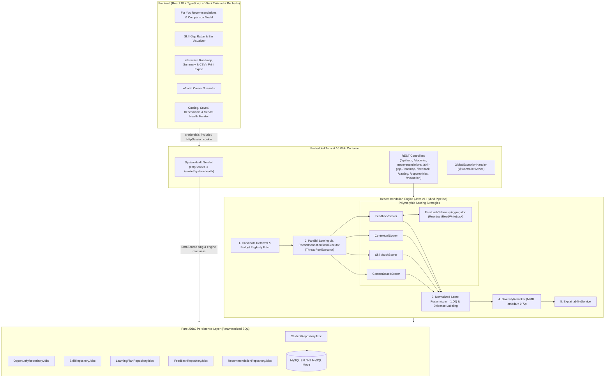

# PathPilot AI 🧭
### Explainable Student Opportunity Recommendation, Career Simulation & Learning Trajectory System

[](https://openjdk.org/projects/jdk/21/)
[](https://spring.io/projects/spring-boot)
[](https://jakarta.ee/specifications/servlet/)
[](https://react.dev/)
[](https://www.typescriptlang.org/)
[](https://vitejs.dev/)
[](https://tailwindcss.com/)
[](https://www.mysql.com/)
[](#-automated-testing--verified-results)

---

## 📖 Executive Summary

Students struggle to navigate courses, projects, internships, and certifications scattered across platforms, while naive recommenders over-index on popularity rather than individual skill gaps, schedule feasibility, prerequisites, and budget limits.

**PathPilot AI** is a full-stack, constraint-aware, explainable career navigation platform built with **Java 21**, **Spring Boot 3**, **Jakarta Servlet API**, **Pure JDBC**, and **React 18 + TypeScript**:

1. **Core Java 21 & OOP Architecture**: Strict encapsulation, polymorphic `Opportunity` inheritance hierarchy with dynamic method dispatch, interface-driven strategy injection, and a custom exception hierarchy translated centrally by `@ControllerAdvice`.
2. **Genuine Jakarta Servlet Integration (`SystemHealthServlet`)**: Custom `HttpServlet` registered at `/servlet/system-health` via `ServletRegistrationBean`, sharing the Spring/Hikari `DataSource`, thread-pool diagnostics, and `HttpSession` tracking cleanly without exposing credentials or internals.
3. **Deterministic Hybrid Scoring + MMR Diversity Reranking**: Multi-criteria normalized scoring (`content`, `skill`, `contextual`, `feedback`, weights summing to `1.00`) paired with a Maximal Marginal Relevance (`DiversityReranker`) toggle and honest evidence-basis labels (`LIMITED_DATA_COLD_START`, `PROFILE_BASED`, `FEEDBACK_SUPPORTED`).
4. **High-Throughput Concurrency & Synchronization**: Managed `ThreadPoolExecutor` (`CompletableFuture.supplyAsync` candidate evaluation) paired with lock-protected shared telemetry (`ConcurrentHashMap`, `AtomicInteger`, `DoubleAdder`, and `ReentrantReadWriteLock`).
5. **Pure JDBC Persistence & Startup Reliability**: Parameterized SQL across all repositories, consistent generated-key extraction (`new String[]{"id"}`), transactional boundaries, idempotent non-destructive schema/seed initialization (`CREATE TABLE IF NOT EXISTS` + `SeedDataInitializer`), and `DatabaseConnectionFailureAnalyzer` startup diagnostics.
6. **Session Security & Innovation Suite**: PBKDF2-HMAC-SHA256 credential hashing, `HttpSession` authentication with session-ID rotation and cross-user ownership guards (`401`/`403`), **Side-by-Side Comparison**, **Non-Destructive What-If Career Simulator**, and **Weekly Progress Summary + CSV/Print Export**.

---

## 📑 Table of Contents

- [System Architecture](#-system-architecture)
- [Key Features & UI Views](#-key-features--ui-views)
- [Jakarta Servlet Integration](#-jakarta-servlet-integration)
- [Security & Session Access Control](#-security--session-access-control)
- [Object-Oriented Design & Exception Hierarchy](#-object-oriented-design--exception-hierarchy)
- [Collections, Generics & Complexity](#-collections-generics--complexity)
- [Multithreading & Shared-State Synchronization](#-multithreading--shared-state-synchronization)
- [Recommendation Mathematics & Diversity Reranking](#-recommendation-mathematics--diversity-reranking)
- [Pure JDBC & Database Schema](#-pure-jdbc--database-schema)
- [Technology Stack](#-technology-stack)
- [Getting Started & Configuration](#-getting-started--configuration)
- [REST API & Servlet Reference](#-rest-api--servlet-reference)
- [Automated Testing & Verified Results](#-automated-testing--verified-results)
- [Project Directory Structure](#-project-directory-structure)

---

## 🏛 System Architecture



---

## ✨ Key Features & UI Views

### Core & Innovation Capabilities
- **Explainable Recommendations with Honest Evidence Basis**:
  - Every card shows career relevance, pacing/budget compliance, prerequisite readiness, matched skills, and weighted sub-scores (`Content`, `Skill Match`, `Context`, `Feedback & Telemetry`).
  - Uses explicit data-evidence tags rather than uncalibrated probability claims: `LIMITED_DATA_COLD_START` (0 recorded skills), `PROFILE_BASED` (skills present without interaction history), and `FEEDBACK_SUPPORTED` (skills + interaction signals).
- **MMR Diversity Reranking (`diverse=true|false`)**:
  - Toggle Maximal Marginal Relevance reranking (`DiversityReranker`) on Discovery and Simulation views to balance top relevance scores against variety across opportunity types (`COURSE`, `PROJECT`, `INTERNSHIP`, `CERTIFICATION`) and skill overlap.
- **Side-by-Side Opportunity Comparison (`ComparisonModal`)**:
  - Select 2–3 opportunities to inspect cost, hours, competencies gained, remaining missing role skills, and algorithmic sub-scores side-by-side before adding to a roadmap.
- **Non-Destructive What-If Career Simulator**:
  - Test alternate target roles, weekly study hours, budget limits, difficulty preferences, and hypothetical skills to preview role readiness shifts (`Baseline % → Simulated %`) and ranking changes (`NEW_ENTRY`, `MOVED_UP`, `MOVED_DOWN`, `UNCHANGED`) with **`persisted: false`**. Profile records update only when clicking **Apply Simulation to My Profile**.
- **Weekly Progress Summary & Exportable Roadmap**:
  - Displays completed hours, remaining hours, estimated weeks left at current weekly pace, and projected role skill coverage gain.
  - Supports **RFC-4180 CSV export** (with spreadsheet formula-injection neutralization) and **Print / PDF** output via print-specific CSS (`@media print`).
- **Cold-Start Guidance & Public Browsing**:
  - Zero-skill profiles shift toward content/contextual matching and display actionable cold-start guidance, while unauthenticated visitors can browse **Catalog**, **Benchmarks**, and **Health** or start instantly via **1-Click Demo Personas**.

### Application Navigation Views
| View | Access | Highlights |
|------|--------|------------|
| **For You** (`DiscoveryPage`) | Authenticated | Hybrid AI rankings, cold-start guidance banner, MMR toggle, 2–3 item Compare selection, star ratings, Save/Dismiss, Add to Roadmap |
| **Skill Gap** (`SkillGapPage`) | Authenticated | Role selector, readiness percentage, Recharts Bar & Radar views, Matched / Needs Growth / Missing Critical Skills |
| **Roadmap** (`RoadmapPage`) | Authenticated | Weekly progress summary cards, sequenced milestone controls (`In Progress`, `Done`, `Skip`), Regenerate, CSV Export, Print/PDF |
| **Simulator** (`SimulatorPage`) | Authenticated | What-If role/hours/budget/difficulty/skill sliders, preview rank deltas (`persisted: false`), explicit Apply button |
| **Catalog** (`CatalogPage`) | Public (bookmark/add when signed in) | Keyword, type, and difficulty search across courses, projects, internships, certifications |
| **Saved** (`SavedPage`) | Authenticated | Curated backlog of bookmarked opportunities |
| **Benchmarks** (`EvaluationPage`) | Public | Live offline evaluation (`Precision@K`, `Recall@K`, `NDCG@K`, `Catalog Coverage`) comparing Hybrid AI vs Popularity Baseline |
| **Health** (`SystemStatusPage`) | Public | Live probe console for `SystemHealthServlet` (`/servlet/system-health`) with `detail` and `trackSession` controls |

---

## 🔌 Jakarta Servlet Integration

[`SystemHealthServlet`](backend/src/main/java/com/pathpilot/servlet/SystemHealthServlet.java) extends `jakarta.servlet.http.HttpServlet` and runs alongside Spring MVC on embedded Apache Tomcat (`jakarta.servlet.*`). Registered declaratively in [`ServletConfig.java`](backend/src/main/java/com/pathpilot/config/ServletConfig.java) at `/servlet/system-health` with `loadOnStartup = 1` and `serviceName` init parameter:

- **Lifecycle Methods**:
  - `init()`: Records startup instant and reads configured `serviceName` from `ServletConfig`.
  - `doGet()`: Validates query parameters (`detail=summary|engine|session`, `trackSession=true|false`), verifies live DB connectivity through the managed `DataSource` using try-with-resources (`SELECT 1` + `Connection.isValid(2)`), inspects [`RecommendationTaskExecutor`](backend/src/main/java/com/pathpilot/concurrency/RecommendationTaskExecutor.java) pool health and catalog size, tracks safe `HttpSession` check counts, sets `application/json; charset=UTF-8` and `Cache-Control: no-store`, and returns `200`, `400` (invalid parameter), or `503` (DB/engine degraded).
  - `destroy()`: Logs clean shutdown after total handled requests.
- **Strict Redaction**: Never returns JDBC connection URLs, database credentials, raw `PATHPILOT_SESSION` tokens, password hashes, or stack traces.

### Example Servlet Requests (`curl`)

```bash
# 1. Inspect database latency, thread pool readiness & create/increment HttpSession counter
curl -i -c cookies.txt "http://localhost:8080/servlet/system-health?detail=engine"

# 2. Verify session counter increments across requests using the stored session cookie
curl -s -b cookies.txt "http://localhost:8080/servlet/system-health?detail=session"

# 3. Passive health probe without creating or incrementing an HttpSession
curl -s "http://localhost:8080/servlet/system-health?trackSession=false"

# 4. Invalid parameter handling (returns HTTP 400 BAD_REQUEST)
curl -i "http://localhost:8080/servlet/system-health?detail=invalid"
```

---

## 🔐 Security & Session Access Control

- **Password Hashing**: [`PasswordHasher`](backend/src/main/java/com/pathpilot/util/PasswordHasher.java) hashes passwords with per-user `SecureRandom` salts using PBKDF2-HMAC-SHA256 and constant-time `MessageDigest.isEqual` verification; `passwordHash` is annotated with `@JsonIgnore`.
- **Session Rotation & Hardened Cookie Defaults**: [`AuthSessionService`](backend/src/main/java/com/pathpilot/service/AuthSessionService.java) invalidates pre-existing sessions and mints a fresh session on login, registration, and profile switches (`HttpOnly=true`, `SameSite=Lax`, configurable `SESSION_COOKIE_SECURE`), storing only minimal non-sensitive identifiers (`studentId`, `studentName`, `authenticated`).
- **Ownership Guards (`401` / `403`)**: Protected endpoints under `/api/students/**`, `/api/recommendations/**`, `/api/skill-gap/**`, `/api/roadmap/**`, and `/api/feedback/**` verify active session identity and reject cross-user access with `403 Forbidden`.
- **Demo Persona Restriction**: `POST /api/auth/demo-login` is permitted solely for seeded demo accounts (`is_demo = TRUE`); attempting demo-login against regular accounts returns `403 Forbidden`. Initial demo passwords can be configured via `PATHPILOT_DEMO_PASSWORD`.
- **Explicit CORS Configuration**: [`CorsConfig`](backend/src/main/java/com/pathpilot/config/CorsConfig.java) restricts allowed origins via `CORS_ALLOWED_ORIGINS` without wildcard origins/headers when credentials are enabled.

---

## 🧩 Object-Oriented Design & Exception Hierarchy

### Polymorphic Opportunity Hierarchy
Abstract base [`Opportunity`](backend/src/main/java/com/pathpilot/model/opportunity/Opportunity.java) encapsulates shared validation, cost/schedule checks, and abstract polymorphic contracts implemented by:
- `CourseOpportunity`
- `ProjectOpportunity`
- `InternshipOpportunity`
- `CertificationOpportunity`

Subclasses override `calculateDifficultyPenalty(StudentProfile)`, `getOpportunityType()`, and `getOpportunityBadge()` to apply type-specific readiness penalties dynamically at runtime.

### Custom Exception Hierarchy & HTTP Translation
Exceptions derive from `PathPilotException` and map cleanly through [`GlobalExceptionHandler`](backend/src/main/java/com/pathpilot/controller/GlobalExceptionHandler.java):
- `InvalidRecommendationRequestException` + Bean Validation (`@Valid`) -> `400 Bad Request`
- `AuthenticationRequiredException` -> `401 Unauthorized`
- `UnauthorizedAccessException` -> `403 Forbidden`
- `ResourceNotFoundException` -> `404 Not Found`
- `DuplicateResourceException` -> `409 Conflict`
- `DatabaseOperationException` -> `500 Internal Server Error` (safe generic message, full error logged server-side)

---

## 📊 Collections, Generics & Complexity

| Operation | Data Structure | Complexity | Purpose |
|-----------|----------------|------------|---------|
| Student Skill Lookup | `Map<String, StudentSkill>` | $O(1)$ avg | Case-insensitive proficiency retrieval during scoring & simulation |
| Role Benchmark Mapping | `Map<String, TargetRoleSkill>` | $O(1)$ avg | Fast lookup of target role proficiency bars and importance weights |
| MMR Redundancy Precomputation | `IdentityHashMap<RecommendationItem, Set<String>>` | $O(K^2)$ | Fast skill-set caching & `EnumMap<OpportunityType, Integer>` saturation tracking in [`DiversityReranker`](backend/src/main/java/com/pathpilot/recommendation/rerank/DiversityReranker.java) |
| Ranking Order | `List<RecommendationItem>` + `Comparator` | $O(N \log N)$ | Deterministic score descending ordering (`BY_RANKING_SCORE_DESC`) |
| Thread-Safe Telemetry | `ConcurrentHashMap<Long, TelemetryStats>` | $O(1)$ avg | Lock-free `AtomicInteger` & `DoubleAdder` counters paired with `ReentrantReadWriteLock` |
| API Envelope | `ApiResponse<T>` | $O(1)$ | Type-safe generic REST response wrapper |

---

## ⚡ Multithreading & Shared-State Synchronization

1. **Managed Thread Pool ([`RecommendationTaskExecutor`](backend/src/main/java/com/pathpilot/concurrency/RecommendationTaskExecutor.java))**: Backed by a named-thread `ThreadPoolExecutor` (`pathpilot-scorer-N`), bounded timeout (`2500ms` default), `CallerRunsPolicy` backpressure, graceful `@PreDestroy` shutdown, and read-only health metrics (`activeThreads`, `corePoolSize`, `queuedTasks`, `isHealthy()`).
2. **Asynchronous Candidate Scoring**: `HybridRecommendationStrategy` evaluates eligible candidates in parallel via `CompletableFuture.supplyAsync(...)` and `CompletableFuture.allOf(...)`.
3. **Lock-Protected Telemetry ([`FeedbackTelemetryAggregator`](backend/src/main/java/com/pathpilot/concurrency/FeedbackTelemetryAggregator.java))**: Coordinates concurrent saves/dismissals/ratings using `AtomicInteger`, `DoubleAdder`, and explicit `ReentrantReadWriteLock` (`readLock` for non-blocking multiplier lookups; `writeLock` for consistent snapshots).

---

## 🧮 Recommendation Mathematics & Diversity Reranking

Default hybrid score $S(u, i)$ uses normalized weights summing to `1.00` ($0.25$ content $+ 0.45$ skill $+ 0.18$ contextual $+ 0.12$ feedback; cold-start profiles shift to $0.40$ content $+ 0.30$ skill $+ 0.18$ contextual $+ 0.12$ feedback):

$$S(u, i) = \text{clamp}_{[0, 1]}\Big(\big(w_c S_{\text{content}} + w_s S_{\text{skill}} + w_x S_{\text{context}} + w_f S_{\text{feedback}}\big) \cdot M_{\text{telemetry}}(i)\Big)$$

- **$S_{\text{content}}$**: Stopword-filtered Jaccard token overlap + direct target-role alignment boost.
- **$S_{\text{skill}}$**: Prerequisite readiness ($0.35$) + weighted role-gap/skill-upgrade coverage ($0.65$).
- **$S_{\text{context}}$**: Budget ceiling fit ($0.35$) + weekly hours pacing fit ($0.35$) + $(1 - \text{DifficultyPenalty})$ ($0.30$).
- **$S_{\text{feedback}}$**: Bayesian-smoothed crowd rating prior ($m = 10, C = 4.0$) merged with user history.
- **MMR Diversity Reranking (`DiversityReranker`, when `diverse=true`)**: Iteratively selects the next item maximizing:

$$\text{MMR}(i) = 0.72 \cdot S(u, i) - 0.28 \cdot \big(0.55 \cdot \text{TypeSaturation}(i) + 0.45 \cdot \max_{j \in \text{Selected}} \text{Jaccard}(\text{Skills}_i, \text{Skills}_j)\big)$$

---

## 🗄 Pure JDBC & Database Schema

All SQL persistence runs directly via Spring `JdbcTemplate` and `PreparedStatement` with `try-with-resources`, parameterized bindings, `new String[]{"id"}` generated-key retrieval ([`JdbcUtils`](backend/src/main/java/com/pathpilot/util/JdbcUtils.java)), and `@Transactional` boundaries—**no ORM/JPA/Hibernate**.

- **Schema DDL**: [`database/schema.sql`](database/schema.sql) and [`backend/src/main/resources/schema.sql`](backend/src/main/resources/schema.sql) use `CREATE TABLE IF NOT EXISTS` for non-destructive startups.
- **Seed Data**: [`database/seed.sql`](database/seed.sql) and [`SeedDataInitializer`](backend/src/main/java/com/pathpilot/config/SeedDataInitializer.java) idempotently insert canonical skills, role benchmarks, 14 catalog opportunities, and initial demo personas when absent without duplicating or overwriting user changes.
- **Startup Diagnostics**: [`DatabaseConnectionFailureAnalyzer`](backend/src/main/java/com/pathpilot/config/DatabaseConnectionFailureAnalyzer.java) (registered via [`spring.factories`](backend/src/main/resources/META-INF/spring.factories)) emits clear configuration tips if an external DB connection fails.

---

## 💻 Technology Stack

| Layer | Technologies |
|-------|-------------|
| **Backend** | Java 21 LTS, Spring Boot 3.2.5 (`web`, `jdbc`, `validation`), Jakarta Servlet 6.0 (embedded Tomcat 10.1.20), MySQL Connector/J, H2 (`MODE=MySQL`), Apache Maven 3.9, JUnit 5, Mockito |
| **Frontend** | React 18.3.1, TypeScript 5.4.5, Vite 5.2.11, Tailwind CSS 3.4.3, Recharts 2.12.7, Lucide React 0.378.0 |
| **Database** | MySQL 8.0 compatible schema with H2 MySQL-mode zero-setup fallback |

---

## 🚀 Getting Started & Configuration

### Prerequisites
- **Java 21 LTS JDK**
- **Apache Maven 3.8+**
- **Node.js 18+ & npm**
- **MySQL 8.0** *(optional — runs out-of-the-box with embedded H2 `MODE=MySQL;DATABASE_TO_LOWER=TRUE` when MySQL env vars are not supplied)*

### Option 1: Standalone Full-Stack Executable JAR

#### Linux / macOS (`bash`)
```bash
# 1. Build React bundle & sync into Spring Boot static resources
cd frontend
npm install
npm run build
rm -rf ../backend/src/main/resources/static/*
cp -r dist/* ../backend/src/main/resources/static/

# 2. Run all tests and package executable JAR
cd ../backend
mvn clean package

# 3. Launch full-stack application on http://localhost:8080
java -jar target/pathpilot-backend-1.0.0.jar
```

#### Windows (`PowerShell`)
```powershell
# 1. Build React bundle & sync into Spring Boot static resources
cd frontend
npm install
npm run build
Remove-Item ..\backend\src\main\resources\static\* -Recurse -Force -ErrorAction SilentlyContinue
Copy-Item dist\* ..\backend\src\main\resources\static\ -Recurse -Force

# 2. Run all tests and package executable JAR
cd ..\backend
mvn clean package

# 3. Launch full-stack application on http://localhost:8080
java -jar target\pathpilot-backend-1.0.0.jar
```

### Option 2: External MySQL 8.0 Configuration

Configure environment variables from [`.env.example`](.env.example):

```bash
export DB_URL="jdbc:mysql://localhost:3306/pathpilot_db?createDatabaseIfNotExist=true&useSSL=false&allowPublicKeyRetrieval=true&serverTimezone=UTC"
export DB_USERNAME="your_db_user"
export DB_PASSWORD="your_db_password"
export DB_DRIVER="com.mysql.cj.jdbc.Driver"
java -jar backend/target/pathpilot-backend-1.0.0.jar
```

*(Optional)* Initialize manually via SQL scripts:
```bash
mysql -u root -p pathpilot_db < database/schema.sql
mysql -u root -p pathpilot_db < database/seed.sql
```

### Option 3: Development Mode (Hot Reload)

```bash
# Terminal 1: Backend (:8080)
cd backend && mvn spring-boot:run

# Terminal 2: Frontend (:5173, proxies /api and /servlet to :8080)
cd frontend && npm install && npm run dev
```

---

## 📡 REST API & Servlet Reference

| Access | Method | Endpoint | Description |
|--------|--------|----------|-------------|
| Public | `GET` | `/servlet/system-health?detail=engine&trackSession=true` | Jakarta `HttpServlet`: DB ping, pool metrics & `HttpSession` tracking |
| Public | `GET` | `/api/auth/me` | Current `HttpSession` authentication state |
| Public | `GET` | `/api/auth/demo-profiles` | Non-sensitive list of built-in demo personas |
| Public | `POST` | `/api/auth/login` | Email + password session sign-in |
| Public | `POST` | `/api/auth/demo-login` | Switch into a built-in `is_demo = TRUE` persona |
| Public | `POST` | `/api/auth/logout` | Invalidate active `HttpSession` |
| Public | `POST` | `/api/students/register` | Register a `@Valid` student account and start session |
| Owner | `GET` | `/api/students/{id}` | Retrieve authenticated student's own profile & skills |
| Owner | `PUT` | `/api/students/{id}` | Update profile constraints, career goal & skills |
| Owner | `GET` | `/api/recommendations/student/{id}?limit=8&diverse=true` | Generate explainable recommendations with optional MMR reranking |
| Owner | `GET` | `/api/recommendations/student/{id}/latest` | Retrieve persisted recommendations from JDBC history |
| Owner | `POST` | `/api/recommendations/student/{id}/compare` | Side-by-side comparison for 2–3 opportunity IDs |
| Owner | `POST` | `/api/recommendations/student/{id}/simulate` | Non-destructive What-If career simulation (`persisted: false`) |
| Owner | `GET` | `/api/skill-gap/student/{id}?targetRole=...` | Diagnostic proficiency comparison vs target role benchmark |
| Owner | `GET` | `/api/roadmap/student/{id}` | Retrieve sequenced learning roadmap milestones |
| Owner | `POST` | `/api/roadmap/student/{id}/generate` | Regenerate sequenced learning trajectory in JDBC transaction |
| Owner | `POST` | `/api/roadmap/student/{id}/add` | Add an individual catalog or recommended opportunity cleanly |
| Owner | `GET` | `/api/roadmap/student/{id}/summary` | Weekly progress hours, remaining weeks & projected skill coverage gain |
| Owner | `GET` | `/api/roadmap/student/{id}/export?format=csv` | Download RFC-4180 formula-safe CSV roadmap |
| Owner | `PATCH` | `/api/roadmap/item/{itemId}` | Update milestone status or target completion weeks |
| Owner | `DELETE` | `/api/roadmap/item/{itemId}` | Delete milestone from student's roadmap |
| Owner | `POST` | `/api/feedback/student/{id}` | Submit `SAVED`, `DISMISSED`, `RATED`, or `COMPLETED` interaction |
| Owner | `GET` | `/api/feedback/student/{id}` | List recorded student interactions |
| Public | `GET` | `/api/catalog/skills`, `/api/catalog/roles` | Browse canonical skills and role benchmarks |
| Public | `GET` | `/api/opportunities` | Search opportunity catalog by keyword, type, difficulty, cost |
| Public | `GET` | `/api/evaluation/run?topK=5` | Run Precision@K, Recall@K, NDCG@K & Catalog Coverage benchmarks |

---

## 🧪 Automated Testing & Verified Results

Run the full backend JUnit 5 & Spring Boot integration test suite:

```bash
cd backend
mvn test
```

### Test Suites Covered (10 Suites)
- `SystemHealthServletTest`: Embedded Tomcat container routing (`/servlet/system-health`), `init()`/`destroy()` lifecycle, `HttpSession` counter propagation across cookies, query parameter validation (`400`), `trackSession=false`, redaction checks, and `503` degraded DB response.
- `SecurityAndControllerIntegrationTest`: `401` unauthenticated blocks, `403` cross-user isolation, session-ID rotation on auth, `@Valid` validation (`400`), PBKDF2 password login, post-logout `401` invalidation, and `403` demo-login restriction on non-demo users.
- `CareerSimulatorAndComparisonTest`: Side-by-side comparison (`200`/`400`) and non-destructive What-If simulation confirming persisted DB records stay unchanged.
- `DiversityRerankerTest`: MMR trade-off between relevance and type/skill diversity plus rank stability.
- `JdbcAndDatabaseReliabilityTest`: Idempotent re-seeding without duplicate/overwritten rows and `DatabaseConnectionFailureAnalyzer` diagnostics.
- `OpportunityPolymorphismTest`, `RecommendationScoringTest`, `ConcurrencySynchronizationTest`, `EvaluationServiceTest`, and `RoadmapServiceTest`.

### Observed Build & Live End-to-End Verification
- **Frontend Build**: `npx tsc --noEmit` (`exit 0`) + `vite build` (`2107 modules transformed`, `exit 0`), synced into `backend/src/main/resources/static/`.
- **Backend Build & Test Suite**: `mvn -o clean package` completed cleanly with **`Tests run: 24, Failures: 0, Errors: 0, Skipped: 0`**, producing `backend/target/pathpilot-backend-1.0.0.jar`.
- **Live Packaged JAR E2E Probe** (`java -jar target/pathpilot-backend-1.0.0.jar --server.port=18080`):
  - `GET /` (`200`), `GET /servlet/system-health?detail=engine` & `detail=session` (`200 UP`, session count `1 -> 2`), `detail=invalid` (`400`).
  - Public APIs (`/api/auth/demo-profiles`, `/api/opportunities`, `/api/evaluation/run?topK=3` Precision@3=`0.889`).
  - Auth & Ownership (`401` unauthenticated, `403` cross-user isolation, `200` own profile, post-logout `401`).
  - Hybrid Recommendations (`diverse=true`, `FEEDBACK_SUPPORTED`), `POST /compare` (`3` items), non-destructive `POST /simulate` (`persisted=false`), `/roadmap/.../add` + `/summary` + `text/csv` export, and new registration cold-start (`coldStart=true`, `LIMITED_DATA_COLD_START`).
- **Database Environment Note**: Automated verification ran with local MySQL 8 offline, exercising H2 in MySQL compatibility mode (`MODE=MySQL;DATABASE_TO_LOWER=TRUE`); MySQL 8 schema and connection configuration remain externalized via `.env.example`.

---

## 📂 Project Directory Structure

```text
pathpilot-ai/
├── .env.example
├── .gitignore
├── README.md
├── database/
│   ├── schema.sql                                 # Non-destructive MySQL 8.0 DDL schema
│   └── seed.sql                                   # Idempotent skills, role benchmarks & opportunities
├── backend/
│   ├── pom.xml                                    # Java 21, Spring Boot 3.2.5, JDBC, MySQL/H2, JUnit 5
│   └── src/
│       ├── main/
│       │   ├── java/com/pathpilot/
│       │   │   ├── PathPilotApplication.java
│       │   │   ├── config/                        # ServletConfig, CorsConfig, SeedDataInitializer, FailureAnalyzer
│       │   │   ├── servlet/                       # SystemHealthServlet (extends HttpServlet)
│       │   │   ├── controller/                    # REST Controllers + GlobalExceptionHandler
│       │   │   ├── dto/                           # Bean-validated Request/Response DTOs
│       │   │   ├── model/                         # Domain entities, RelevanceBasis & polymorphic Opportunity hierarchy
│       │   │   ├── exception/                     # Custom PathPilotException hierarchy
│       │   │   ├── repository/jdbc/               # Pure JDBC repositories with parameterized SQL
│       │   │   ├── service/                       # Business logic & AuthSessionService
│       │   │   ├── recommendation/
│       │   │   │   ├── scoring/                   # Content, SkillMatch, Contextual, Feedback scorers
│       │   │   │   ├── rerank/                    # DiversityReranker (MMR)
│       │   │   │   └── strategy/                  # HybridRecommendationStrategy & PopularityBaseline
│       │   │   ├── concurrency/                   # RecommendationTaskExecutor & FeedbackTelemetryAggregator
│       │   │   ├── evaluation/                    # Precision@K, Recall@K, NDCG@K & Coverage evaluator
│       │   │   └── util/                          # JdbcUtils & PasswordHasher (PBKDF2-HMAC-SHA256)
│       │   └── resources/
│       │       ├── META-INF/spring.factories
│       │       ├── application.properties
│       │       ├── schema.sql
│       │       └── static/                        # Compiled React SPA bundle (synced before JAR build)
│       └── test/java/com/pathpilot/               # 10 JUnit 5 / Spring Boot test suites
└── frontend/
    ├── package.json
    ├── vite.config.ts                             # Proxies /api and /servlet in dev mode
    ├── tailwind.config.js
    └── src/
        ├── App.tsx
        ├── types/index.ts
        ├── api/client.ts
        ├── components/                            # Navbar, ExplainableCard, AuthGateModal, ComparisonModal, Modals
        └── pages/                                 # Discovery, SkillGap, Roadmap, Simulator, Catalog, Saved, Benchmarks, SystemStatus
```
