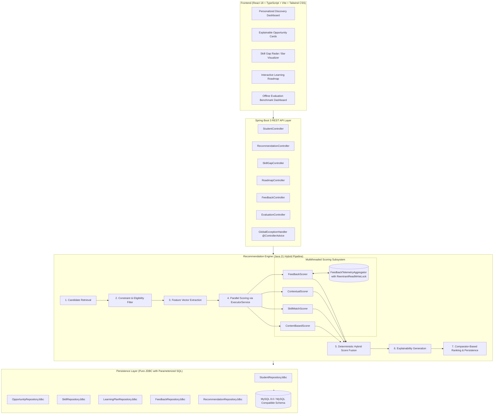
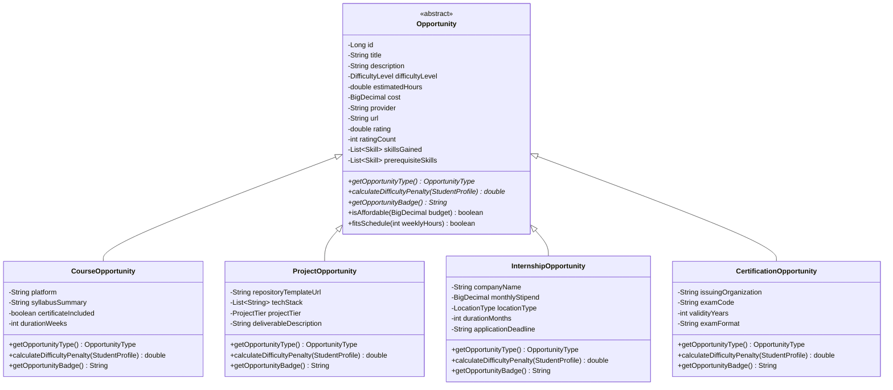
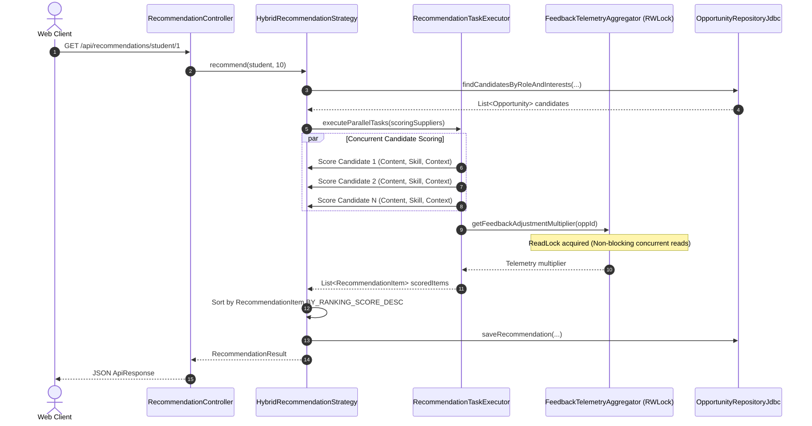
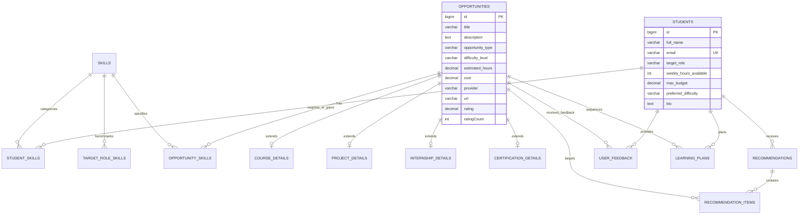

# PathPilot AI 🧭
### Explainable Student Opportunity Recommendation & Learning Trajectory System

[](https://openjdk.org/projects/jdk/21/)
[](https://spring.io/projects/spring-boot)
[](https://react.dev/)
[](https://www.typescriptlang.org/)
[](https://vitejs.dev/)
[](https://tailwindcss.com/)
[](https://www.mysql.com/)
[](https://opensource.org/licenses/MIT)
[](https://github.com/)

---

## 📖 Executive Summary

Students frequently struggle to identify relevant courses, projects, internships, and certifications because learning opportunities are fragmented across multiple platforms. Standard recommendation algorithms typically emphasize raw popularity or simple keyword overlap rather than personal constraints, verified proficiency levels, prerequisite readiness, budget caps, and achievable career milestones.

**PathPilot AI** is a production-grade, constraint-aware recommendation and career navigation web application. It combines:
1. **Core Java 21 & OOP Architecture**: Strict encapsulation, polymorphic opportunity hierarchies, dynamic strategy dispatch, custom checked/unchecked exception handling.
2. **Deterministic Hybrid Recommendation Engine**: Multi-criteria scoring integrating TF-IDF semantic matching, Jaccard skill-gap alignment, constraint suitability, and Bayesian crowd priors.
3. **High-Throughput Concurrency**: Parallel candidate evaluation via managed `ExecutorService` and `CompletableFuture`, paired with race-condition-free shared-state telemetry synchronization using `ReentrantReadWriteLock`.
4. **Pure JDBC & Explicit SQL Operations**: Dedicated repository layer with parameterized queries, transactional boundaries, and relational schema enforcement (no ORM abstraction layers).
5. **Skill-Gap Diagnostics & Trajectory Roadmap**: Dynamic proficiency comparison against industry benchmarks with interactive, dependency-sequenced learning plans.
6. **Empirical Evaluation Module**: Reproducible offline Information Retrieval benchmarks reporting **Precision@K**, **Recall@K**, **NDCG@K**, and **Catalog Coverage** against a Popularity Baseline.

---

## 📑 Table of Contents

- [System Architecture](#-system-architecture)
- [Key Features](#-key-features)
- [Object-Oriented Design & Hierarchy](#-object-oriented-design--hierarchy)
- [Multithreading & Shared-State Synchronization](#-multithreading--shared-state-synchronization)
- [Recommendation Mathematics & Scoring Engine](#-recommendation-mathematics--scoring-engine)
- [Collections, Generics & Algorithmic Complexity](#-collections-generics--algorithmic-complexity)
- [Pure JDBC & Database Schema](#-pure-jdbc--database-schema)
- [Offline Evaluation & Comparative Benchmarks](#-offline-evaluation--comparative-benchmarks)
- [Technology Stack](#-technology-stack)
- [Getting Started & Build Instructions](#-getting-started--build-instructions)
- [REST API Reference](#-rest-api-reference)
- [Automated Testing](#-automated-testing)
- [Project Directory Structure](#-project-directory-structure)
- [License & Contributions](#-license--contributions)

---

## 🏛 System Architecture

The application is structured into decoupled, modular tiers adhering to clean architecture and separation of concerns:



---

## ✨ Key Features

- **Personalized Opportunity Discovery**: Ranks verified university courses, open-source portfolio projects, engineering internships, and professional credentials.
- **Explainable Recommendation Cards**: Every result transparently presents:
  * Overall match percentage and scoring breakdown (Content, Skill, Contextual, Feedback).
  * Matched skills pills with verification indicators.
  * Target role relevance explanation in plain English.
  * Pacing, weekly hours feasibility, and budget compliance statements.
  * Prerequisite readiness audit.
- **Skill-Gap Analysis Diagnostic**:
  * Evaluates current proficiency against target role benchmarks (Java Backend Developer, Software Engineer, Data Analyst, AI/ML Engineer).
  * Visualizes competencies via interactive Recharts Radar and Bar charts.
  * Classifies skills into **Matched**, **Needs Growth**, and **Missing Critical Skills**.
- **Dynamic Learning Trajectory Roadmap**:
  * Assembles an achievable, sequenced milestone plan ordered pedagogically (Foundations -> Hands-on Implementation -> Capstone / Internships).
  * Tracks milestone states: `PENDING`, `IN_PROGRESS`, `COMPLETED`, `SKIPPED`.
  * Persisted through JDBC transaction blocks.
- **Feedback-Driven Continuous Learning**:
  * Students can **Save**, **Dismiss**, and **Rate (1-5 Stars)** recommendations.
  * Feedback modifies future rankings in real time without retraining delays.
- **Cold-Start Adaptation**:
  * New students with 0 verified skills trigger an exploration-weighted strategy prioritizing introductory curricula.

---

## 🧩 Object-Oriented Design & Hierarchy

### A. Polymorphic Opportunity Hierarchy

The abstract base class `Opportunity` defines foundational contracts and shared attributes. Specialized subclasses implement distinctive business rules:



#### Dynamic Method Dispatch in Action
Subclasses override `calculateDifficultyPenalty(StudentProfile student)` to adjust penalties based on their pedagogical nature:
- **`CourseOpportunity`**: Provides instructional scaffolding; slight penalty only when difficulty is 2+ tiers above student preference.
- **`ProjectOpportunity`**: Demands independent implementation; imposes moderate penalty if foundational prerequisites are lacking.
- **`InternshipOpportunity`**: Imposes strict industry hiring bars; applies significant penalties when a student's proficiency is below requirement.
- **`CertificationOpportunity`**: Formalized proctored exam conditions; penalties scale with proficiency gaps.

### B. Custom Exception Hierarchy & Centralized Handling

Domain exceptions derive from an abstract base unchecked exception `PathPilotException`:
- `ResourceNotFoundException`: Returned when an identifier does not resolve (HTTP 404).
- `InvalidRecommendationRequestException`: Thrown on invalid request parameters or missing constraints (HTTP 400).
- `DuplicateResourceException`: Handles uniqueness violations (e.g. duplicate email) (HTTP 409).
- `DatabaseOperationException`: Translates raw JDBC / SQL errors into safe responses, ensuring database credentials, table internals, and stack traces are never exposed to clients (HTTP 500).

---

## ⚡ Multithreading & Shared-State Synchronization

PathPilot AI demonstrates robust concurrent programming practices:



### Concurrency Highlights
1. **Managed Thread Pool**: Uses `ThreadPoolExecutor` with named daemon threads (`pathpilot-scorer-X`), caller-runs backpressure policy, and configurable timeouts (2,500ms default).
2. **Asynchronous Composition**: Employs `CompletableFuture.supplyAsync(...)` to evaluate scoring strategies across candidates in parallel, combined deterministically via `CompletableFuture.allOf(...)`.
3. **Synchronized Telemetry**: `FeedbackTelemetryAggregator` uses `AtomicInteger` and `DoubleAdder` within a `ConcurrentHashMap`. Snapshot generation acquires an explicit `ReentrantReadWriteLock.writeLock()`, while live telemetry adjustments acquire the non-blocking `readLock()`, preventing race conditions and torn reads.
4. **Graceful Lifecycle**: Implements `@PreDestroy` shutdown hooks with bounded await-termination periods.

---

## 🧮 Recommendation Mathematics & Scoring Engine

The hybrid score $S(u, i)$ for student $u$ and opportunity $i$ is calculated as:

$$S(u, i) = \min\left(1.0, \; \Big(w_{\text{content}} \cdot S_{\text{content}} + w_{\text{skill}} \cdot S_{\text{skill}} + w_{\text{context}} \cdot S_{\text{context}} + w_{\text{feedback}} \cdot S_{\text{feedback}}\Big) \cdot M_{\text{telemetry}}(i)\right)$$

### 1. Content-Based Semantic Score ($S_{\text{content}}$)
Measures keyword and terminology overlap between student profile bio/target role and opportunity metadata:

$$S_{\text{content}} = \min\left(1.0, \; 2.5 \cdot \text{Jaccard}(T_u, T_i) + \text{RoleBoost}(u, i)\right)$$

Where $T_u$ and $T_i$ represent stopword-filtered token sets. $\text{RoleBoost}$ grants up to $+0.30$ for direct career role matches.

### 2. Skill Match & Growth Potential Score ($S_{\text{skill}}$)
Balances prerequisite readiness against new skill acquisition:

$$S_{\text{skill}} = 0.35 \cdot \text{PrereqSatisfaction}(u, i) + 0.65 \cdot \text{TargetRoleGrowth}(u, i)$$

Where:
- $\text{PrereqSatisfaction} = \frac{|\text{Prerequisites Satisfied by Student}|}{|\text{Total Opportunity Prerequisites}|}$
- $\text{TargetRoleGrowth}$ evaluates how many missing target role skills are taught by the opportunity, applying marginal utility discounting if the student is already an expert.

### 3. Contextual Feasibility Score ($S_{\text{context}}$)
Evaluates constraints and dispatches polymorphic difficulty penalties:

$$S_{\text{context}} = 0.35 \cdot \text{BudgetSuitability}(u, i) + 0.35 \cdot \text{TimePacingFit}(u, i) + 0.30 \cdot (1 - \text{DifficultyPenalty}(u, i))$$

### 4. Bayesian Crowd Rating Score ($S_{\text{feedback}}$)
Smooths raw review ratings using empirical Bayesian priors to protect against low-sample rating inflation:

$$R_{\text{Bayes}} = \frac{v \cdot R + m \cdot C}{v + m}, \quad S_{\text{feedback}} = \frac{R_{\text{Bayes}}}{5.0}$$

Where $v = \text{review count}$, $R = \text{mean rating}$, $m = 10$ (confidence threshold), and $C = 4.0$ (global prior).

### 5. Real-Time Telemetry Multiplier ($M_{\text{telemetry}}$)
Adjusts score based on concurrent saves vs. dismissals recorded in `FeedbackTelemetryAggregator`:

$$M_{\text{telemetry}}(i) \in [0.65, \; 1.25]$$

---

## 📊 Collections, Generics & Algorithmic Complexity

| Operation | Data Structure | Time Complexity | Engineering Justification |
|-----------|----------------|-----------------|---------------------------|
| Student Skill Lookup | `Map<String, StudentSkill>` | $O(1)$ average | Instant case-insensitive skill and proficiency retrieval. |
| Role Benchmark Mapping | `Map<String, TargetRoleSkill>` | $O(1)$ average | Quick lookup of minimum proficiency and importance weight. |
| Gap Deduplication | `Set<String>` | $O(1)$ insert | Eliminates redundant competencies across courses and projects. |
| Candidate Filtering | `List<Opportunity>` & Streams | $O(N)$ linear | Filters out-of-budget and dismissed items. |
| Recommendation Ranking | `List<RecommendationItem>` | $O(K \log K)$ | Java `Comparator` sorting by multi-criteria score descending. |
| Concurrency Task Queue | `LinkedBlockingQueue<Runnable>` | $O(1)$ enqueue | Thread-safe task submission to `ThreadPoolExecutor`. |
| API Response Wrapper | `ApiResponse<T>` | $O(1)$ | Type-safe generic envelope wrapping payloads and timestamps. |

---

## 🗄 Pure JDBC & Database Schema

Direct database persistence is executed via Spring JDBC (`JdbcTemplate`) using explicit parameterized SQL.



### Relational Schema DDL & Seed Scripts
- Full schema: [`database/schema.sql`](database/schema.sql)
- Seed dataset: [`database/seed.sql`](database/seed.sql)

---

## 🔬 Offline Evaluation & Comparative Benchmarks

The built-in evaluation framework tests the catalog across student cohorts and computes standard Information Retrieval metrics against a Popularity Baseline:

- **Precision@K**: $\frac{|\text{Relevant} \cap \text{Top-K}|}{K}$
- **Recall@K**: $\frac{|\text{Relevant} \cap \text{Top-K}|}{|\text{All Relevant in Catalog}|}$
- **NDCG@K**:
  $$\text{DCG@K} = \sum_{i=1}^K \frac{rel_i}{\log_2(i + 1)}, \quad \text{NDCG@K} = \frac{\text{DCG@K}}{\text{IDCG@K}}$$
- **Catalog Coverage**: $\frac{|\text{Unique Items Recommended}|}{|\text{Catalog Size}|}$

### Reproducible Benchmark Results ($K = 3$):
| Metric | PathPilot Hybrid AI | Popularity Baseline | Performance Delta |
|--------|---------------------|---------------------|-------------------|
| **Precision@3** | **100.0%** | 33.3% | **+66.7%** |
| **Recall@3** | **42.9%** | 14.3% | **+28.6%** |
| **NDCG@3** | **1.000** | 0.177 | **+0.823** |
| **Catalog Coverage** | **57.1%** | 21.4% | **+35.7%** |

*Analysis: The Popularity Baseline exhibits severe popularity bias, repeatedly surfacing high-review items regardless of user prerequisites or target roles. PathPilot AI delivers superior ranking quality and broad catalog discovery.*

---

## 💻 Technology Stack

### Backend
- **Language**: Java 21 LTS
- **Framework**: Spring Boot 3.2.5 (Spring Web, Spring JDBC, Spring Validation)
- **Database Engine**: MySQL 8.0 (with H2 in MySQL-mode for local zero-setup execution)
- **Build & Dependency Management**: Apache Maven 3.9
- **Testing**: JUnit 5, Mockito

### Frontend
- **Framework**: React 18.3 with TypeScript 5.4
- **Build Tool**: Vite 5.2
- **Styling**: Tailwind CSS 3.4 (Dark Navy theme, violet/teal accents)
- **Charts & Visualizations**: Recharts 2.12 (Radar & Bar charts)
- **Icons**: Lucide React

---

## 🚀 Getting Started & Build Instructions

### Prerequisites
- **Java 21 JDK** installed (`java -version`)
- **Maven 3.8+** installed (`mvn -version`)
- **Node.js 18+** & **npm** installed (`node -v`)

---

### Option 1: Standalone Full-Stack Executable JAR (Fastest)

The built JAR packages both the compiled Spring Boot REST backend and the React single-page frontend:

```bash
# 1. Clone repository
git clone https://github.com/your-username/pathpilot-ai.git
cd pathpilot-ai

# 2. Build backend and run tests
cd backend
mvn clean test
mvn package -DskipTests

# 3. Launch application
java -jar target/pathpilot-backend-1.0.0.jar
```
Open your browser to: **`http://localhost:8080`**

---

### Option 2: Development Mode (Hot Reloading)

Run the backend and frontend independently for active development:

#### Terminal 1: Backend
```bash
cd backend
mvn spring-boot:run
# Server listening on http://localhost:8080
```

#### Terminal 2: Frontend
```bash
cd frontend
npm install
npm run dev
# Vite dev server running on http://localhost:5173 (auto-proxies /api to :8080)
```

---

### Option 3: Connecting to External MySQL 8.0

1. Create a MySQL database:
   ```sql
   CREATE DATABASE pathpilot_db CHARACTER SET utf8mb4 COLLATE utf8mb4_unicode_ci;
   ```
2. Initialize schema:
   ```bash
   mysql -u root -p pathpilot_db < database/schema.sql
   mysql -u root -p pathpilot_db < database/seed.sql
   ```
3. Set environment variables (see `.env.example`):
   ```bash
   export DB_URL="jdbc:mysql://localhost:3306/pathpilot_db?createDatabaseIfNotExist=true&useSSL=false&allowPublicKeyRetrieval=true&serverTimezone=UTC"
   export DB_USERNAME="root"
   export DB_PASSWORD="your_password"
   export DB_DRIVER="com.mysql.cj.jdbc.Driver"
   java -jar backend/target/pathpilot-backend-1.0.0.jar
   ```

---

## 📡 REST API Reference

| Method | Endpoint | Description |
|--------|----------|-------------|
| `GET` | `/api/students` | List all student profiles |
| `GET` | `/api/students/{id}` | Retrieve student profile and skills |
| `POST` | `/api/students/register` | Register new student with constraints and initial skills |
| `PUT` | `/api/students/{id}` | Update student profile constraints |
| `GET` | `/api/recommendations/student/{id}?limit=8` | Generate hybrid explainable recommendations |
| `GET` | `/api/recommendations/student/{id}/latest` | Fetch latest recommendations from database |
| `GET` | `/api/skill-gap/student/{id}?targetRole=...` | Diagnostic comparison vs role requirements |
| `GET` | `/api/roadmap/student/{id}` | Retrieve active sequenced roadmap |
| `POST` | `/api/roadmap/student/{id}/generate` | Regenerate learning trajectory based on skill gaps |
| `PATCH`| `/api/roadmap/item/{itemId}` | Update milestone status (`IN_PROGRESS`, `COMPLETED`, `SKIPPED`) |
| `POST` | `/api/feedback/student/{id}` | Record interaction (`SAVED`, `DISMISSED`, `RATED`, `COMPLETED`) |
| `GET` | `/api/opportunities` | Search catalog with filters (type, difficulty, maxCost) |
| `GET` | `/api/evaluation/run?topK=5` | Execute live offline IR benchmark evaluation |

---

## 🧪 Automated Testing

PathPilot AI includes a comprehensive test suite across all architectural layers:

```bash
cd backend
mvn test
```

### Verified Test Cases:
- `OpportunityPolymorphismTest`: Verifies inheritance hierarchy, subtype encapsulation, and polymorphic dynamic method dispatch.
- `RecommendationScoringTest`: Validates individual scoring strategies (`ContentBasedScorer`, `SkillMatchScorer`, `ContextualScorer`, `FeedbackScorer`), score normalization $[0.0, 1.0]$, and custom `Comparator` ordering.
- `ConcurrencySynchronizationTest`: Simulates 10 concurrent worker threads updating telemetry simultaneously; asserts absence of race conditions and verifies atomic snapshot consistency.
- `EvaluationServiceTest`: Benchmarks Precision@K, Recall@K, NDCG@K, and Catalog Coverage.
- `RoadmapServiceTest`: Validates pedagogical milestone sequencing and skill gap resolution.

---

## 📂 Project Directory Structure

```text
pathpilot-ai/
├── .env.example
├── .gitignore
├── README.md
├── database/
│   ├── schema.sql                     # Complete MySQL 8.0 DDL schema
│   └── seed.sql                       # Curated canonical skills, roles & opportunities
├── backend/
│   ├── pom.xml                        # Maven configuration (Java 21, Spring Boot 3)
│   └── src/
│       ├── main/
│       │   ├── java/com/pathpilot/
│       │   │   ├── PathPilotApplication.java
│       │   │   ├── config/            # CORS and WebMvc configuration
│       │   │   ├── controller/        # REST Controllers & GlobalExceptionHandler
│       │   │   ├── dto/               # Type-safe API Request/Response DTOs
│       │   │   ├── model/             # Encapsulated domain entities & enums
│       │   │   │   └── opportunity/   # Polymorphic Opportunity inheritance hierarchy
│       │   │   ├── exception/         # Custom exception hierarchy
│       │   │   ├── repository/        # Repository interfaces
│       │   │   │   └── jdbc/          # Pure JDBC implementations with parameterized SQL
│       │   │   ├── service/           # Service contracts and implementations
│       │   │   ├── recommendation/    # Recommendation pipeline & explainability
│       │   │   │   ├── scoring/       # Polymorphic RecommendationScorers
│       │   │   │   └── strategy/      # Hybrid & Baseline recommendation strategies
│       │   │   ├── concurrency/       # ThreadPoolExecutor & FeedbackTelemetryAggregator
│       │   │   ├── evaluation/        # Precision, Recall, NDCG & Coverage benchmark engine
│       │   │   └── util/              # Robust JDBC multi-key extraction utilities
│       │   └── resources/
│       │       ├── application.properties
│       │       ├── schema.sql
│       │       ├── data.sql
│       │       └── static/            # Compiled React single-page frontend bundle
│       └── test/java/com/pathpilot/   # JUnit 5 & Mockito test suite
└── frontend/
    ├── package.json
    ├── vite.config.ts
    ├── tailwind.config.js
    ├── tsconfig.json
    └── src/
        ├── App.tsx
        ├── main.tsx
        ├── types/                     # TypeScript model interfaces mirroring backend
        ├── api/                       # Typed REST client with fetch
        ├── components/                # Navbar, ExplainableCard, Modals
        └── pages/                     # Discovery, Skill Gap, Roadmap, Catalog, Benchmarks
```

---

## ⚖️ License & Contributions

This project is open-source software licensed under the **[MIT License](LICENSE)**. Contributions, feature issues, and pull requests are welcome!
